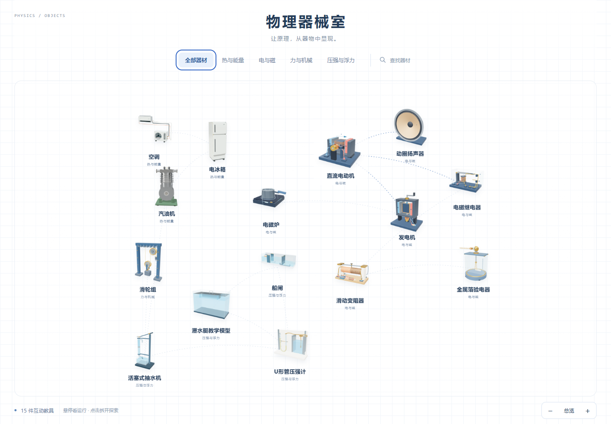

# 物理器械室 · Physics Apparatus Lab

十五件可组装、运行、拆解的交互式物理教具，面向课堂演示与学生自主观察。纯前端运行，蓝白网格界面，支持课堂白板。

[在线体验](https://brin666.github.io/physics-apparatus-lab/) · [MIT License](LICENSE) · [物理与几何复核](qa/PHYSICS-AUDIT.md)



## 可以做什么

- 在器材关系地图中搜索、分类、缩放和平移；悬停打开圆角运行预览。
- 进入器材后观看组装，运行、暂停、调整演示倍速及实验参数。
- 拆解功能总成，单独旋转或移动部件，再平滑组装回去。
- 点击部件查看名称与作用；通过剖切、透视理解内部构造。
- 打开白板冻结演示，绘图、写字并保存课堂记录；记录保存在当前浏览器。

| 方向 | 器材 |
| --- | --- |
| 热与能量 | 汽油机、电冰箱、空调 |
| 电与磁 | 直流电动机、动圈扬声器、电磁继电器、发电机、电磁炉、金属箔验电器、滑动变阻器 |
| 力与机械 | 滑轮组 |
| 压强与浮力 | 潜水艇教学模型、船闸、U形管压强计、活塞式抽水机 |

## 本地运行

需要 Node.js 22 或更新版本，以及支持 WebGL2 的现代浏览器。

```sh
npm ci
npm run build
npm start
```

打开 <http://127.0.0.1:4198/>。Windows PowerShell 如遇脚本执行策略限制，可使用 `npm.cmd`。

```sh
npm test            # 纯模型、几何、状态与存储测试
npm run build:pages # 生成 dist/ 静态站点及许可证
```

构建不依赖网络字体或CDN；首页与器材页内嵌运行所需资源。源码和预先渲染的成品缩略图保存在仓库，生成HTML与本地媒体导出不入库。推送 `main` 会执行测试、构建并发布到 GitHub Pages。

## 开发与验证

- `apparatus/`：新增十二件器材的几何、教学状态、公共交互与测试。
- `machine-scene.mjs` / `model.mjs`：汽油机几何与运动学。
- `refrigeration-*.mjs`：冰箱、空调几何及制冷循环。
- `map-home.*`：器材地图和按需运行预览。
- `whiteboard*`：课堂白板及浏览器本地保存。
- `build.mjs` / `scripts/stage-pages.mjs`：构建与静态发布。
- `qa/`：浏览器检查脚本与审查报告。运行浏览器检查需启动本地服务并安装 Chrome；脚本依赖 Playwright。截图、录屏和临时JSON由检查脚本本地生成。

当前验证包含59项Node测试，以及15个预览和器材交互的本地Chrome检查。具体物理纠正、覆盖范围及简化见 [审查记录](qa/PHYSICS-AUDIT.md) 和 `apparatus/*-notes.md`。浏览器证据属于本地检查，并非每次CI都会重复执行。

## 教学范围与许可证

模型是本站构建的课堂示意，保留必要的比例、慢放与理想化假设。不同器材的公式、适用边界和参考来源可在页面“构造与原理”中查看；教材关联与通用原理参考分别注明。不是实物测绘、维修指导或完整工程仿真。

原创建模、代码、教学文本和项目渲染图按 [MIT](LICENSE) 发布。Machine、Anatomy 与 Three.js 保留各自的MIT版权声明，详见 [第三方授权说明](THIRD_PARTY_NOTICES.md)。外部教材和引用网页不因本仓库发布而改变授权。
